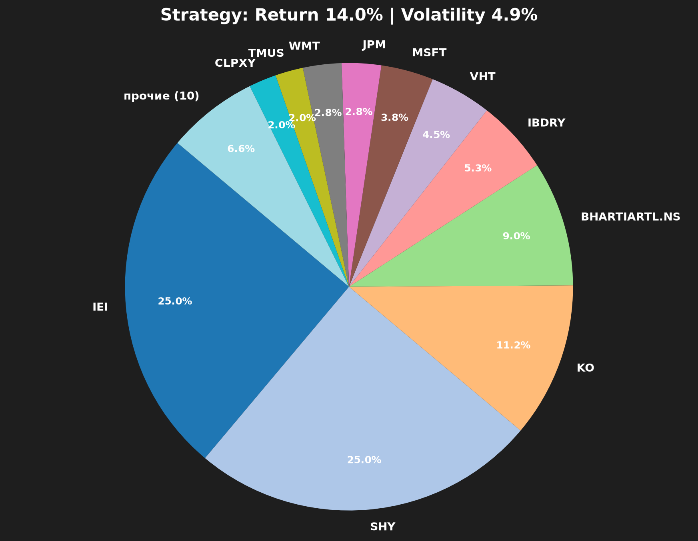

# ESG Quant Scanner

Скоринг активов, который совмещает портфельную теорию с качественным
ESG-анализом через LLM. Каждая бумага получает балл 0–10 по фреймворку PARKS,
из оценённого пула собирается портфель (Марковиц или максимум балла при лимите
риска), результат проверяется Монте-Карло.

<p align="center">
  
</p>

## PARKS

| | | Источник | Метрики |
|---|---|---|---|
| **P** | Profitability | Yahoo, пробелы закрывает LLM | ROE, чистая маржа |
| **A** | Acceleration | Yahoo, пробелы закрывает LLM | рост выручки |
| **R** | Resilience | расчёт и Yahoo | волатильность, D/E, бета |
| **K** | Knowledge | LLM | качество управления, инновационность |
| **S** | Sustainability | LLM | ESG-профиль минус штраф за скандалы |

Каждая метрика линейно переводится в 0–10 по отраслевому коридору
(`sector_config.py`): ROE 15% — сильный результат для ритейла и средний для
софтверной компании. Свои коридоры есть у шести секторов, остальные считаются
по общей шкале. Компонент — среднее своих метрик, итог — среднее компонентов.

Без ключа LLM проект работает: K и S не оцениваются и в итог не входят,
фундаментал берётся только из Yahoo.

## Запуск

```bash
python -m venv .venv && source .venv/bin/activate   # Windows: .venv\Scripts\activate
pip install -r backend/requirements.txt
cp .env.example .env                                 # ключ LLM — по желанию
python backend/main.py
```

Параметры задаются флагами:

```bash
python backend/main.py --tickers MSFT NVDA V JPM ISRG KO \
                       --target-return 0.16 --max-weight 0.35 \
                       --years 10 --simulations 50000

# максимум средневзвешенного PARKS при волатильности не выше 15%
python backend/main.py --objective max-score --max-volatility 0.15
```

`--max-weight` не может быть меньше `1 / число активов`, иначе веса не
наберут 100%.

Веб-интерфейс — это API и фронтенд в двух терминалах:

```bash
uvicorn api:app --app-dir backend --port 8000
cd frontend && npm ci && npm run dev                 # http://localhost:3000
```

Тесты и линтер:

```bash
pip install -r backend/requirements-dev.txt
pytest
ruff check backend tests
```

## Вывод

Прогон по умолчанию без ключа LLM (30 активов, строки скоринга сокращены):

```
🧐 ШАГ 1: скоринг PARKS (30 активов)
  SHY            10.00/10  [покрытие 33%]  ⚪ Недостаточно данных  ⚠️ мало данных
  MSFT            6.68/10  [покрытие 100%]  🟡 Hold / Neutral (среднее качество)
  SUZLON.NS       8.78/10  [покрытие 100%]  🔥 Core Investment (высочайшее качество)

💼 ИТОГОВЫЙ ПОРТФЕЛЬ: ожидаемая доходность 14.00% | волатильность 4.92%

📊 MONTE CARLO REPORT — горизонт 5 лет, 10,000 путей
🎯 P(CAGR > 14%)                   🙂  47.8%
📈 Медианный CAGR                            13.87%
   ├─ пессимистичный (5%)                       9.73%
   └─ оптимистичный (95%)                      18.16%
📉 Ожидаемая макс. просадка                  -4.08%
💀 Стресс-сценарий (худшие 5%)               -6.11%
💎 Sharpe Ratio                               1.87
```

Цифры зависят от дня запуска: история цен берётся за последние три года.

Поле «покрытие» показывает, сколько из шести количественных метрик удалось
закрыть данными. Если оценено меньше трёх компонентов из пяти, число
выводится, но категория не присваивается: у SHY посчитана только
устойчивость, и 10.00 здесь значит «низкая волатильность», а не «лучший актив
в пуле».

## Структура

```
backend/
  main.py                 CLI и оркестрация
  api.py                  HTTP API для фронтенда (FastAPI)
  config.py               настройки, бутстрап TLS
  data_fetcher.py         Yahoo Finance: цены, фундаментал, кэш
  llm_analyzer.py         веб-поиск и извлечение метрик через LLM
  company_scorer.py       PARKS
  sector_config.py        отраслевые коридоры
  risk_calculator.py      ковариация, ожидаемые доходности
  portfolio_optimizer.py  SLSQP, два режима
  monte_carlo.py          GBM-симуляция
  visualizer.py           графики
frontend/                 React 19 + TypeScript + Vite
tests/                    pytest
```

## Заметки по реализации

Волатильность и ковариация считаются численно, а не запрашиваются у модели —
там, где есть точная формула, LLM не даёт преимущества. Фундаментал сначала
берётся из Yahoo. Модель отвечает только за то, чего там нет или что плохо
парсится: показатели ETF и части ADR, репутационные риски.

Пропущенная метрика исключается из среднего, а не заменяется нулём. То же с
компонентами: неоценённый компонент в итог не входит. Иначе балл мерил бы
качество парсинга, а не качество компании.

Ковариация считается на дневных лог-доходностях (выборочная, ×252). Среднее
лог-доходности `m` — это рост медианы, а не ожидаемая доходность: в модели GBM
оно равно `μ − σ²/2`. Оптимизатору нужен дрейф `μ = m + σ²/2`, потому что по
весам линеен именно он. Поправка на волатильность вычитается один раз, уже для
портфеля, в симуляции. Проверка в тестах: если оценить параметры по одному ряду
цен и прогнать симуляцию, медианный CAGR совпадает с историческим.

Целевая и показанная доходность — эффективные годовые ставки (`e^μ − 1`).
Медианный CAGR всегда ниже ожидаемой доходности на «налог на волатильность».
Sharpe считается как `(μ − ln(1 + rf)) / σ`.

Монте-Карло моделирует портфель одним процессом с дрейфом `w·μ` и
волатильностью `√(wᵀΣw)`. Для активов с коррелированными GBM это точное
описание портфеля, который на каждом шаге возвращают к весам `w`, поэтому
траектории отдельных бумаг и разложение Холецкого здесь не нужны. Пути
считаются пачками, память не растёт с `--simulations`. Сид фиксирован
(`RANDOM_SEED`), пустое значение даёт случайные прогоны.

Границы весов для оптимизатора жёсткие. Если цель по доходности недостижима
при заданном `--max-weight`, оптимизатор не ослабляет лимит, а сообщает
максимум, достижимый для этого пула, и строит портфель под него.

Ключ LLM нужен только бэкенду. Фронтенд ходит в `backend/api.py`, а вопрос
ассистенту уходит на сервер вместе с тикером; профиль актива для модели
собирается там же. В переменные `VITE_*` секреты класть нельзя: Vite встраивает
их в публичный бандл.

На Windows с кириллическим именем пользователя libcurl не может открыть
сертификаты certifi и каждый запрос падает с curl error 77. `config.ensure_ca_bundle()`
подставляет тот же файл по ASCII-пути через короткое 8.3-имя. Проверка TLS при
этом не отключается.

## Ограничения

Историческая доходность за три года как оценка будущей — известная слабость
Марковица, и здесь она ничем не сглажена: оптимизатор охотно набирает бумаги,
которые недавно выросли. Портфель с половиной в коротких облигациях и 14%
ожидаемой доходности на картинке выше — следствие именно этого, а не находка.

Данные из веб-поиска не проходят аудит, модель может ошибиться в цифре — для
реальных решений метрики нужно сверять с отчётностью эмитента. Сниппеты поиска
попадают в промпт как есть; ответ модели проверяется по типам и диапазонам, но
оценки K и S остаются мнением модели.

Монте-Карло предполагает логнормальность и постоянную волатильность, реальные
хвосты толще. Бумаги с разных бирж выравниваются по календарю протяжкой
последней цены, из-за чего корреляции между рынками занижаются.

API не имеет авторизации и лимитов запросов и рассчитан на запуск на своей
машине.

Учебный проект. Не является инвестиционной рекомендацией.

## Лицензия

MIT
